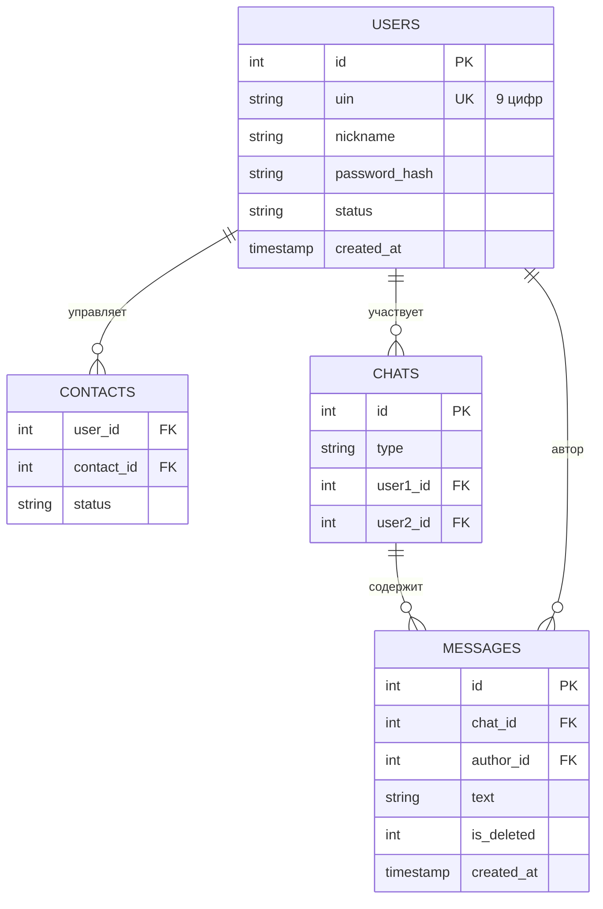

# 🐱 wasqa — веб-мессенджер в стиле ICQ

  
  <h3>Современный мессенджер с духом классического ICQ</h3>
  

    
    
    
    
    
  

---

## 📖 О проекте

**wasqa** — легковесный веб-мессенджер, вдохновлённый классическим ICQ. Проект разработан как пет-проект для демонстрации навыков системного анализа и проектирования ПО.

> 💡 Название *wasqa* — аллюзия на «WhatsApp» + «Q&A» (вопрос-ответ), отсылка к классической коммуникации.

### ✨ Ключевые возможности

- 🎲 **Автоматическая генерация UIN** (9 цифр) — как в оригинальном ICQ
- 💬 **Real-time обмен сообщениями** через нативный WebSocket
- 🟢 **Статусы присутствия** — online / away / do not disturb
- ⌨️ **Индикатор «печатает…»** — видно, когда собеседник набирает текст
- 🔢 **Счётчик непрочитанных** — зелёные бейджи на контактах
- ✏️ **Редактирование и soft-delete** сообщений
- 🗑️ **Управление контактами** — добавление и удаление
- 🎵 **Классический звук «uh-oh»** при новом сообщении
- 🔐 **JWT-аутентификация** с хешированием паролей через bcrypt

---

## 🚀 Быстрый старт

### Требования

- Python 3.10+
- pip

### Установка и запуск

    # 1. Клонируем репозиторий
    git clone https://github.com/YOUR_USERNAME/wasqa.git
    cd wasqa

    # 2. Создаём виртуальное окружение
    python -m venv venv
    source venv/bin/activate          # Linux/Mac
    # venv\Scripts\activate           # Windows

    # 3. Устанавливаем зависимости
    pip install -r backend/requirements.txt

    # 4. Запускаем сервер
    cd backend
    uvicorn main:app --reload --host 0.0.0.0 --port 8000

Откройте в браузере: **http://localhost:8000**

Зарегистрируйтесь, запомните свой UIN — и можно общаться!

> 💬 Для проверки real-time откройте **два браузера** (или Chrome + режим инкогнито) и зарегистрируйте двух пользователей.

---

## 🏗️ Архитектура

### Стек технологий

| Слой | Технология | Обоснование выбора |
|------|-----------|-------------------|
| Backend | Python 3.15 + FastAPI | Быстрая разработка, встроенная поддержка WebSocket |
| База данных | SQLite | Нулевой порог развёртывания, идеально для MVP |
| Frontend | Vanilla JS + HTML/CSS | Минимум зависимостей, нет npm-сборки |
| Real-time | Нативный WebSocket | Без overhead от Socket.IO |
| Аутентификация | JWT + bcrypt | Промышленный стандарт |

### Схема данных (ER-диаграмма)

### Протокол WebSocket

| Событие | Направление | Payload | Назначение |
|---------|-------------|---------|------------|
| `message` | Клиент → Сервер | `{chat_id, text}` | Отправка сообщения |
| `message:new` | Сервер → Клиент | `{msg_id, chat_id, author_id, text, created_at}` | Новое сообщение |
| `message:deleted` | Сервер → Клиент | `{msg_id, chat_id}` | Удаление сообщения |
| `message:edited` | Сервер → Клиент | `{msg_id, chat_id, text}` | Редактирование |
| `typing` | Клиент ↔ Сервер | `{chat_id}` | Индикатор печати |
| `status` | Клиент → Сервер | `{status}` | Смена статуса |
| `presence:update` | Сервер → Клиент | `{user_id, status}` | Обновление статуса контакта |

---

## 📂 Структура проекта

    wasqa/
    ├── backend/
    │   ├── main.py              # FastAPI-приложение + WebSocket-хаб
    │   ├── db.py                # Схема SQLite и коннектор
    │   ├── auth.py              # JWT + bcrypt
    │   ├── models.py            # Pydantic-схемы
    │   └── requirements.txt     # Зависимости Python
    ├── frontend/
    │   ├── index.html           # Single-page приложение
    │   ├── logo.svg             # Логотип «зелёный кот»
    │   └── uh-oh.mp3            # Звук уведомления
    ├── REPORT.md                # Системный отчёт (архитектура + edge cases)
    ├── README.md                # Этот файл
    └── .gitignore

---

## 🔒 Безопасность и 152-ФЗ

### Что реализовано

- **Пароли**: bcrypt с автоматической солью (work factor 12)
- **JWT**: HS256 с 64-символьным секретом, срок жизни 7 дней
- **XSS-защита**: экранирование пользовательского ввода через `textContent`
- **HTTPS-ready**: в продакшене — проксирование через Nginx + Let's Encrypt

### Соответствие 152-ФЗ: стратегия удаления пользователя

Применяется **анонимизация вместо физического удаления** — история переписки сохраняется для других участников:

    UPDATE users 
    SET nickname = 'deleted', 
        password_hash = '', 
        uin = 'deleted_' || id,
        status = 'offline'
    WHERE id = ?;

Такой подход соответствует принципу минимизации данных и позволяет сохранить целостность чатов.

---

## ⚠️ Технический долг (осознанные компромиссы)

| Ограничение | Причина | Решение для продакшена |
|-------------|---------|------------------------|
| Presence в памяти | Быстрый MVP | Redis с TTL |
| Typing в RAM | Ephemeral-события | Redis Pub/Sub |
| SQLite | Zero-setup | PostgreSQL + Alembic |
| Нет retry-логики | MVP | Exponential backoff |
| Нет rate-limiting | MVP | Redis + sliding window |

> 📝 Подробнее о принятых архитектурных решениях и рассмотренных edge cases — в [REPORT.md](./REPORT.md).

---

## 🗺️ Планы развития (v2.0)

- [ ] Групповые чаты с ролями (админ / участник)
- [ ] Загрузка файлов (S3/MinIO + presigned URLs)
- [ ] Полнотекстовый поиск по сообщениям
- [ ] Push-уведомления (Web Push API + Service Workers)
- [ ] Миграция на PostgreSQL + Alembic (версионирование схемы)
- [ ] Docker Compose для развёртывания
- [ ] Unit-тесты и интеграционные тесты (pytest)
- [ ] CI/CD через GitHub Actions

---

## 🎓 Учебный контекст

Проект выполнен в рамках курса по системному анализу. Ключевые учебные цели:

1. Проектирование архитектуры real-time приложения
2. Работа с контрактами API (REST + WebSocket)
3. Понимание edge cases (блокировки, offline-доставка, 152-ФЗ)
4. Документирование технических решений
5. Осознанный выбор стека и принятие компромиссов

---

## 🤝 Вклад в проект

Это образовательный пет-проект. Форк и эксперименты приветствуются!

## 📜 Лицензия

MIT © 2026

---

  <b>Сделано с любовью как портфолио системного аналитика</b>

📞 Контакты
telegram: @therandomname
email: iamthealeksei@gmail.com